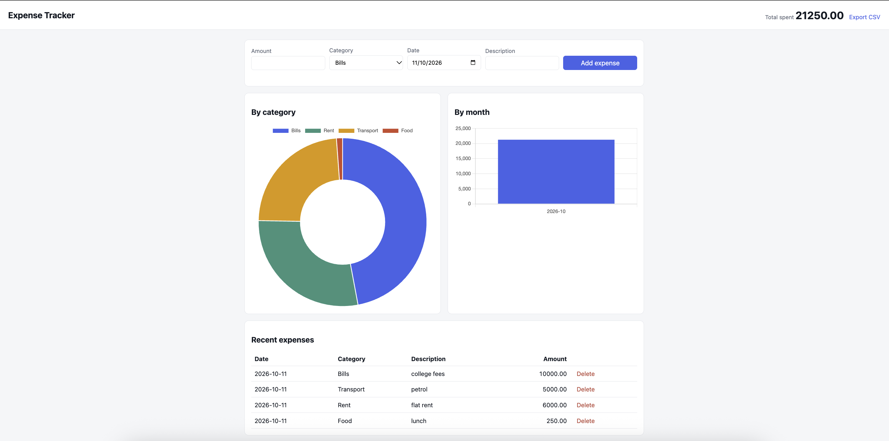

# Expense Tracker

A small full-stack web app for logging expenses and seeing where your money goes. Built with Flask, SQLite and Chart.js.

## Features

- Add expenses with an amount, category, date and description
- Delete expenses
- Dashboard with total spend, a spending-by-category chart and a monthly totals chart
- Export all expenses to CSV
- Input validation on the server (amount, category, date format)

## Tech stack

- **Backend:** Python, Flask, SQLite (standard library `sqlite3`)
- **Frontend:** HTML, CSS, vanilla JavaScript, Chart.js
- **API:** JSON REST endpoints

## Run it locally

```bash
pip install -r requirements.txt
or
python3 app.py
```

Then open http://127.0.0.1:5000 in your browser. The database file `expenses.db` is created automatically on first run.

## API

| Method | Endpoint | Description |
|--------|----------|-------------|
| GET | `/api/expenses` | List all expenses |
| POST | `/api/expenses` | Add an expense (`amount`, `category`, `spent_on`, `description`) |
| DELETE | `/api/expenses/<id>` | Delete an expense |
| GET | `/api/summary` | Total, totals by category, totals by month |
| GET | `/export.csv` | Download all expenses as CSV |

## Screenshot


Add a screenshot of your dashboard here (save it as `screenshot.png` and link it).

## Ideas for next steps

- Monthly budget with an alert when you go over it
- Filter expenses by date range or category
- User login so each person has their own data
- Deploy it (Render or PythonAnywhere both have free tiers)
